<p align="center">
  
</p>

<h1 align="center">OneLedger</h1>

<p align="center">
  本地优先、快速、清晰的 Android 个人记账应用
</p>

<p align="center">
  <strong>简体中文</strong> · <a href="README.en.md">English</a>
</p>

<p align="center">
  
  
  
  
  
</p>

OneLedger 是一款仍在开发中的本地记账应用。它把快速记账、月度预算、收支日历、资产摘要和消费统计放进一个统一的 Compose 界面中，不要求注册，也不依赖云端才能完成核心记账流程。

> [!IMPORTANT]
> 当前版本为 `v0.1.0` 本地 MVP，适合开发、学习与测试。应用尚未完成正式的数据导出和备份能力；卸载应用可能清除全部本地账本，请勿将当前构建作为重要财务数据的唯一副本。

## 为什么是 OneLedger

- **本地优先**：账单保存在设备的 Room/SQLite 数据库中，当前应用不声明网络权限。
- **快速记账**：支出、收入、转账、分类、账户、备注和时间在一个流程中完成。
- **预算可预先规划**：可浏览过去和未来月份，并提前设置未来月份的总预算与分类预算。
- **日历直览**：每个日期同时展示支出与收入；无账单时显示中国节日或农历日期。
- **金额计算可靠**：金额以最小货币单位 `Long` 保存，加减表达式使用 `BigDecimal` 结算。
- **统一交互**：自定义金额键盘与系统输入法互斥交接，深浅主题共享同一套视觉和动效语言。

## 页面展示

以下图片直接来自项目的 Compose 截图回归基准。

### 四个主页面

<table>
  <tr>
    <td align="center" width="25%">
      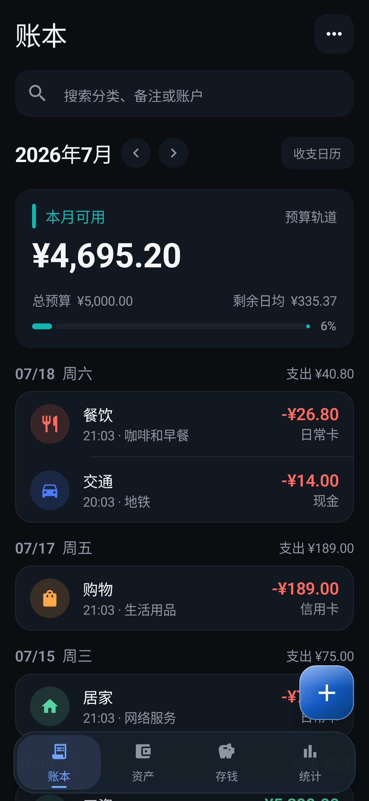<br />
      <strong>账本</strong><br />
      <sub>预算摘要、每日账单与快速记账</sub>
    </td>
    <td align="center" width="25%">
      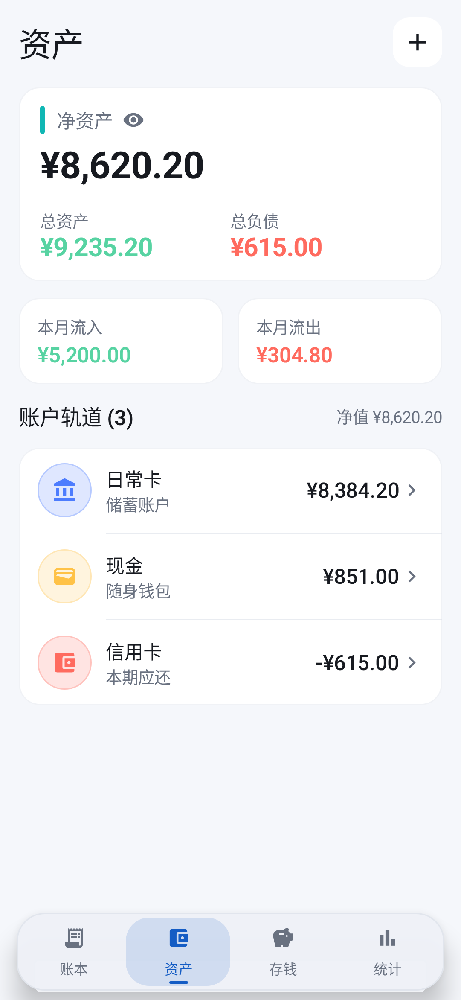<br />
      <strong>资产</strong><br />
      <sub>净资产、资产负债与账户余额</sub>
    </td>
    <td align="center" width="25%">
      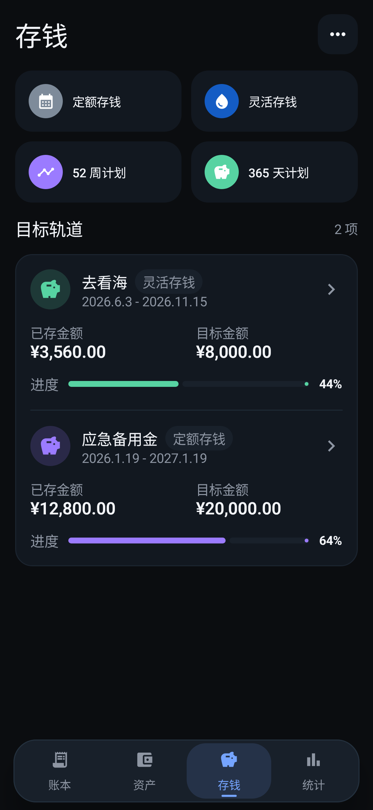<br />
      <strong>存钱</strong><br />
      <sub>存钱方法与计划进度原型</sub>
    </td>
    <td align="center" width="25%">
      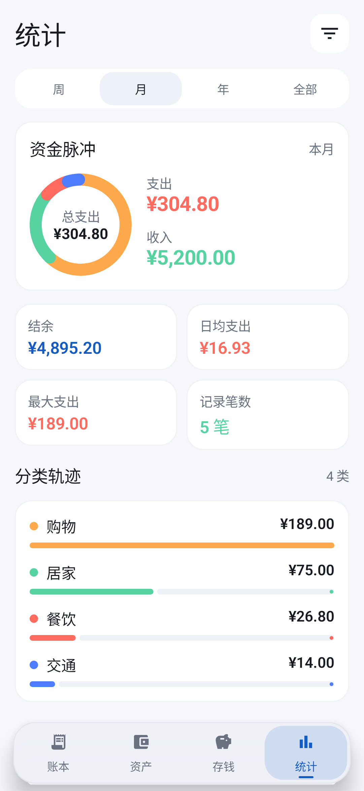<br />
      <strong>统计</strong><br />
      <sub>收支摘要、趋势与分类排行</sub>
    </td>
  </tr>
</table>

### 核心记账流程

<table>
  <tr>
    <td align="center" width="33%">
      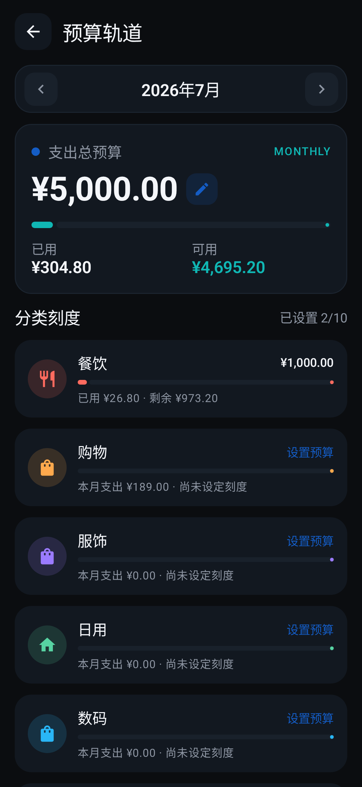<br />
      <strong>预算轨道</strong><br />
      <sub>总预算、已用、可用和分类预算</sub>
    </td>
    <td align="center" width="33%">
      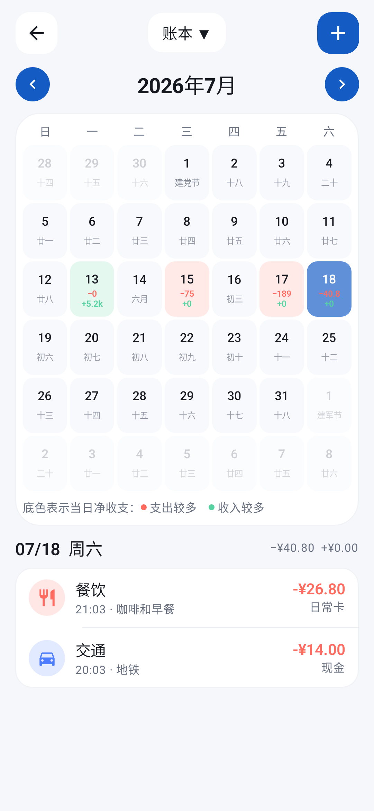<br />
      <strong>收支日历</strong><br />
      <sub>按日期查看收入、支出与当日明细</sub>
    </td>
    <td align="center" width="33%">
      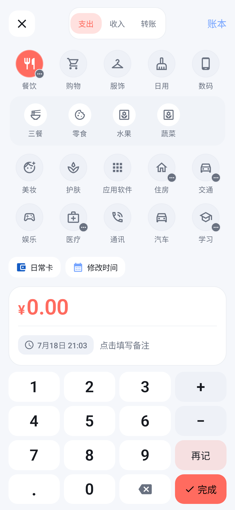<br />
      <strong>快速记账</strong><br />
      <sub>支出、收入、转账与分类选择</sub>
    </td>
  </tr>
</table>

### 输入与编辑

<table>
  <tr>
    <td align="center" width="33%">
      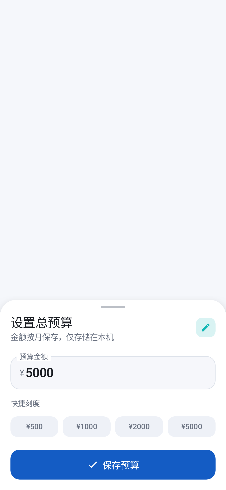<br />
      <strong>预算编辑</strong><br />
      <sub>紧凑金额键盘与即时预算更新</sub>
    </td>
    <td align="center" width="33%">
      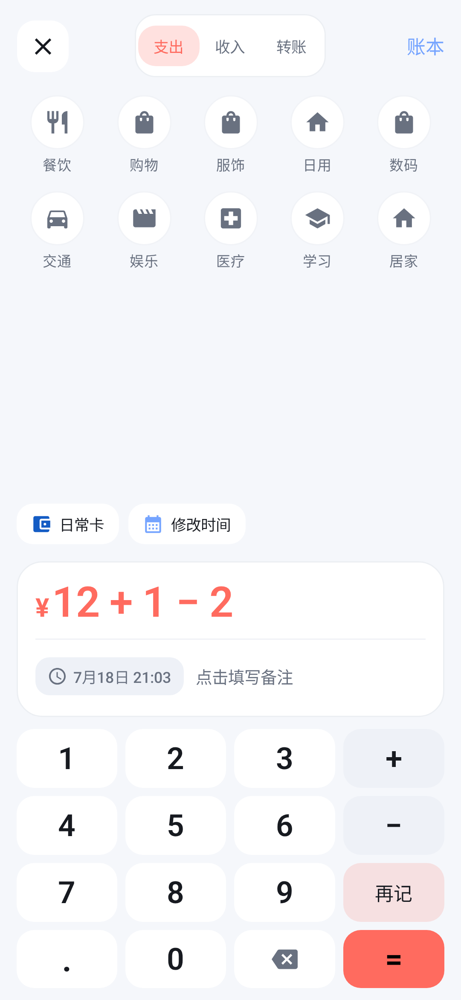<br />
      <strong>金额表达式</strong><br />
      <sub>支持加减、删除、小数与明确等号结算</sub>
    </td>
    <td align="center" width="33%">
      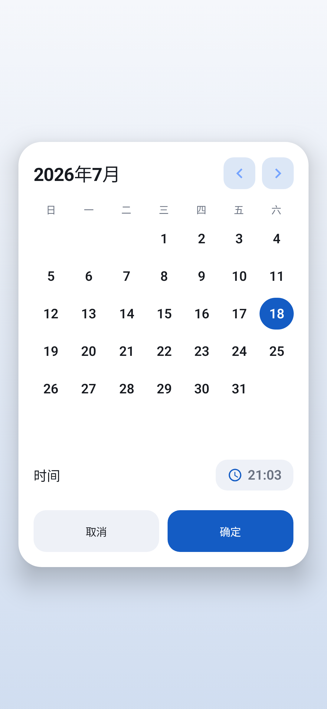<br />
      <strong>日期与时间</strong><br />
      <sub>修改账单发生日期和具体时间</sub>
    </td>
  </tr>
</table>

<details>
  <summary><strong>查看更多页面状态</strong></summary>
  <br />
  <table>
    <tr>
      <td align="center" width="33%">
        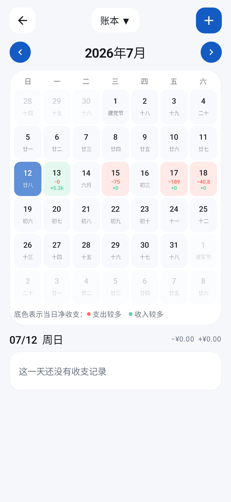<br />
        <strong>日历改选日期</strong>
      </td>
      <td align="center" width="33%">
        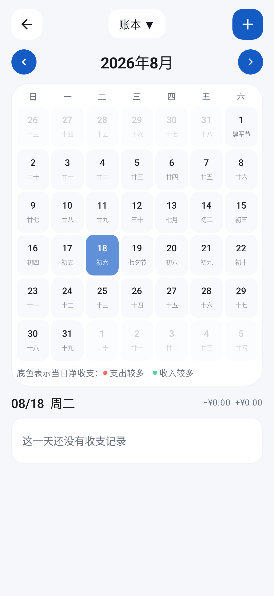<br />
        <strong>日历未来月份</strong>
      </td>
      <td align="center" width="33%">
        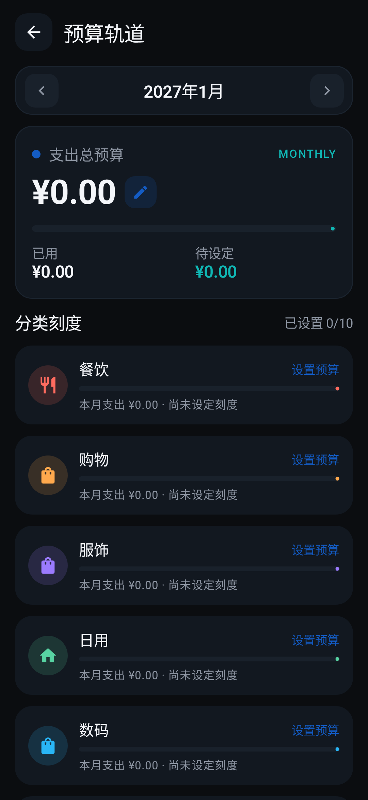<br />
        <strong>未来月份预算</strong>
      </td>
    </tr>
    <tr>
      <td align="center" width="50%">
        <br />
        <strong>账单编辑 · 深色</strong>
      </td>
      <td align="center" width="50%">
        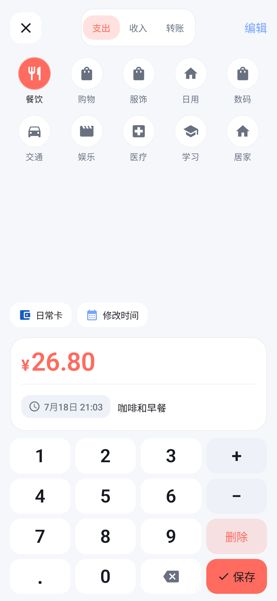<br />
        <strong>账单编辑 · 浅色</strong>
      </td>
    </tr>
  </table>
</details>

<details>
  <summary><strong>品牌图标与启动页</strong></summary>
  <br />
  <table>
    <tr>
      <td align="center" width="50%">
        <br />
        <strong>App Icon 安全区</strong>
      </td>
      <td align="center" width="50%">
        <br />
        <strong>深色启动页</strong>
      </td>
    </tr>
  </table>
</details>

## 当前完成度

| 模块 | 状态 | 当前能力 |
| --- | --- | --- |
| 账本 | 可用 | 月份切换、预算摘要、按日账单、编辑、软删除、撤销和快速记账 |
| 快速记账 | 可用 | 支出、收入、转账、分类、账户、备注、日期时间、表达式与连续记账 |
| 预算 | 可用 | 默认预算 ¥0.00、总预算、分类预算、已用/可用/超支和未来月份预算 |
| 收支日历 | 可用 | 六行月份分页、每日收支、节日/农历、日期选择和过去/未来月份 |
| 资产 | 部分可用 | 净资产、资产/负债、本月流入/流出和账户余额聚合 |
| 存钱 | 原型 | 四种方法入口、计划列表和进度；存款流水与完整 CRUD 尚未完成 |
| 统计 | 基础可用 | 周/月/年/范围摘要、趋势和分类排行；大数据聚合仍需优化 |
| 数据层 | 基线完成 | Room schema v3、账本隔离、外键、预算唯一约束与显式迁移 |

尚未完成的主要能力包括：账户/分类管理、完整搜索筛选、导入导出、多账本管理界面、存钱流水、加密备份、无障碍全量审计和可选同步。详细顺序见 [实施路线图](docs/IMPLEMENTATION_ROADMAP.md)。

## 隐私与数据边界

- 当前不要求账号、登录或联网。
- Android Manifest 不声明 `INTERNET` 权限。
- `android:allowBackup="false"`，系统不会自动把账本上传到 Android 备份。
- 所有核心账本数据默认保存在应用私有的 Room/SQLite 数据库中。
- 当前没有成熟的导出/恢复入口，清除应用数据或卸载应用可能造成不可恢复的数据丢失。

## 技术架构

```text
Jetpack Compose UI
        ↓
Immutable UiState + ViewModel
        ↓
Repository（当前账本边界）
        ↓
Room DAO
        ↓
SQLite
```

| 类别 | 技术 |
| --- | --- |
| 语言 | Kotlin 2.3.21、Java 17 |
| UI | Jetpack Compose、Material 3、Compose BOM 2026.06.01 |
| 数据 | Room 2.8.4、SQLite、schema v3 |
| 架构 | 单 Activity、MVVM、Repository、单向数据流 |
| 平台 | minSdk 23、target/compileSdk 36 |
| 测试 | JVM 单元测试、Room 设备测试、Compose Screenshot Test、Lint |

## 本地运行

### 环境

- Android Studio（支持 AGP 9.3）
- JDK 17
- Android SDK 36

### 获取并构建

```bash
git clone https://github.com/Sirens007/OneLedger-Android.git
cd OneLedger-Android
./gradlew assembleDebug
```

Windows PowerShell：

```powershell
.\gradlew.bat assembleDebug
```

Debug APK 生成在：

```text
app/build/outputs/apk/debug/app-debug.apk
```

## 质量检查

```powershell
.\gradlew.bat assembleDebug testDebugUnitTest lintDebug validateDebugScreenshotTest compileDebugAndroidTestKotlin
```

数据库或 DAO 发生变化时，还需要在允许安装测试 APK 的设备上执行：

```powershell
.\gradlew.bat connectedDebugAndroidTest
```

界面发生经过确认的视觉变化后，使用 `updateDebugScreenshotTest` 更新 17 张截图基准；日常提交运行 `validateDebugScreenshotTest`，避免无意覆盖差异。

## 项目文档

- [规范中心](docs/README.md)
- [产品与页面框架](docs/PRODUCT_FRAMEWORK.md)
- [实施路线图与分支地图](docs/IMPLEMENTATION_ROADMAP.md)
- [技术架构](docs/ARCHITECTURE.md)
- [数据完整性基线](docs/DATA_INTEGRITY.md)
- [视觉设计系统](docs/DESIGN_SYSTEM.md)
- [动效与文案规范](docs/MOTION_AND_CONTENT.md)
- [贡献指南](CONTRIBUTING.md)

## 参与贡献

提交功能前请先阅读 [CONTRIBUTING.md](CONTRIBUTING.md) 和 [Git 工作流](docs/GIT_WORKFLOW.md)。每个功能使用独立短期分支，并同步需求文档、测试和必要的截图基准。

## 许可证

OneLedger 使用 [Apache License 2.0](LICENSE) 发布。第三方组件及其许可见 [THIRD_PARTY_NOTICES.md](THIRD_PARTY_NOTICES.md)。
